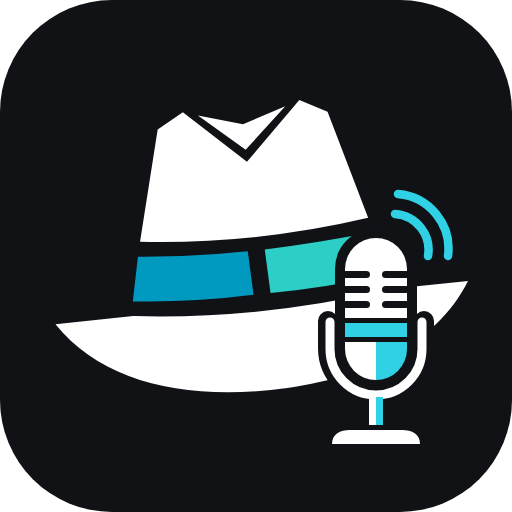

<p align="center">
  
</p>

# PurePodcast

[](https://github.com/LycosLane/purepodcast/releases)
[](https://github.com/LycosLane/purepodcast)
[](LICENSE)
[]()
[]()

> **A straightforward, open-source podcast player for Android.**  
> Subscribe to RSS feeds, download episodes for offline listening, or play audio folders directly from your device. No account, no ads, and no tracking.

---

## Why PurePodcast

Many podcast apps have turned into heavy media platforms with accounts, recommendations, ads, and background telemetry. PurePodcast was built to do one thing well: play podcasts reliably and stay out of the way. Your subscriptions, playback positions, downloads, and backups stay on your device.

---

## Library & Episodes

* **Podcast Grid & Unified Feed:** Switch between your subscribed shows and a combined episode list with quick filters (*Recent 14 days*, *In progress*, *Downloaded*, *Favorites*).
* **Episode Search & Sorting:** Search titles and show notes within a podcast, and toggle oldest-first or newest-first sorting per show.
* **Local Audio Folders:** Point PurePodcast at any folder on your phone or SD card (via Android's Storage Access Framework). Subfolders appear alongside your subscribed podcasts, complete with embedded cover art.
* **Safe Trash & Cleanup:** Deleted downloads move to an in-app trash with configurable retention (`0h`, `24h`, or `48h`) and optional automatic cleanup of played episodes.

---

## Playback & Audio

* **Per-Podcast Settings:** Save playback speed (`0.75x` – `3.0x`) and silence skipping (with adjustable intensity) individually for each show.
* **Chapters & Show Notes:** Supports Podlove and Podcasting 2.0 JSON chapters, plus a readable show-notes view with pinch-to-zoom text scaling.
* **Comfortable Listening:** Includes smart rewind after pauses, optional audio normalization, a sleep timer that keeps running across queued episodes, and configurable Bluetooth next/previous behavior (skip `-10s` / `+30s` or switch queue items).
* **Queue Management:** Persistent mini-player and expandable full player with a dedicated playback queue.

---

## Gestures

* **Swipe right (45%+):** Add episode to the queue (with haptic feedback once the threshold is reached to prevent accidental triggers).
* **Swipe left (45%+):** Hide or unhide an episode (or delete permanently when viewing Trash).
* **Double-tap:** Toggle played status.
* **Long-press:** Open quick actions (*Download newer from here*, *Delete & mark older as played*, *Show Notes*, *Favorite*, *Hide*).

---

## Discovery, Offline Downloads & Backup

* **Search & Preview:** Find podcasts via the iTunes Search API and inspect their feed and episodes before subscribing, or paste any RSS/Atom URL directly.
* **Resumable Downloads:** Download episodes in the background (Wi-Fi only or mobile data) with resume support and conditional feed refreshes (`ETag` / `Last-Modified`).
* **Optional Audio Compression:** Re-encode downloaded episodes to compact AAC (`96` or `128 kbps`, optionally only while charging) to save storage space.
* **OPML & Full Backup:** Import subscriptions from OPML files and export or restore your full library, playback progress, settings, and queue as a single JSON file.

---

## Privacy

* **No account & no tracking:** No analytics, no crash reporting to third parties, and no ad SDKs.
* **Direct connections:** Feeds and episodes are fetched directly from their publishers with SSRF protections and HTTPS downgrade checks.
* **English & German:** Built-in UI support for English and German.

---

## Technical Overview

PurePodcast is written in Kotlin using Jetpack Compose (Material 3), Room, WorkManager, and AndroidX Media3 (`ExoPlayer` + `MediaSessionService`).

```text
app/src/main/java/com/lycoslane/purepodcast/
├── core/
│   ├── audio/       # Media3 ExoPlayer, MediaSessionService, PlayerController, AAC AudioTranscoder
│   ├── database/    # Room entities, migrations (v1–v9), DAO
│   ├── download/    # WorkManager workers (resumable downloads, feed refresh, transcoding)
│   ├── local/       # SAF local folder scanner & embedded cover extractor
│   ├── network/     # Hardened HttpURLConnection, XmlPullParser (RSS/OPML/Chapters), Media3 DataSource
│   └── preferences/ # SharedPreferences-backed AppSettings
├── domain/
│   └── repository/  # PodcastRepository
└── ui/              # Compose screens, sheets, ViewModels, and Material 3 theme
```

### Build from Source

```bash
git clone https://github.com/LycosLane/purepodcast.git
cd purepodcast

# Run unit tests
gradle testDebugUnitTest

# Build debug APK
gradle assembleDebug
```

---

## License

MIT License © 2026 LycosLane
